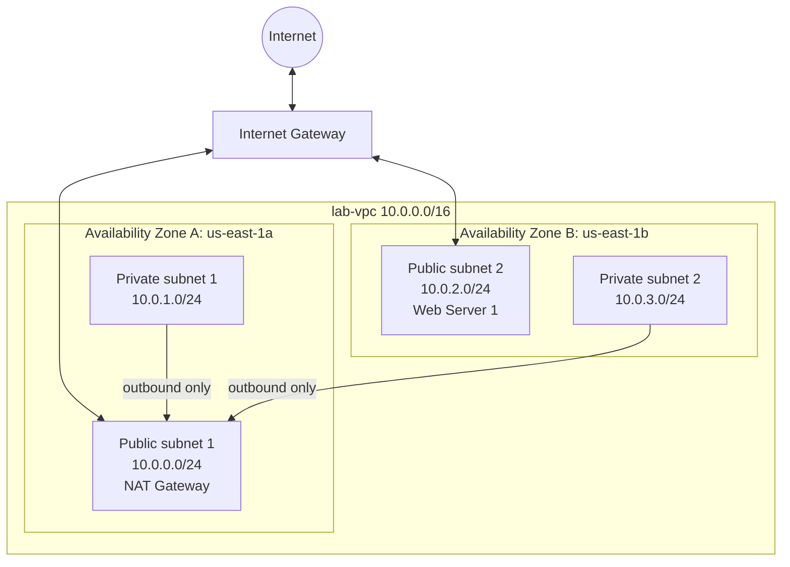
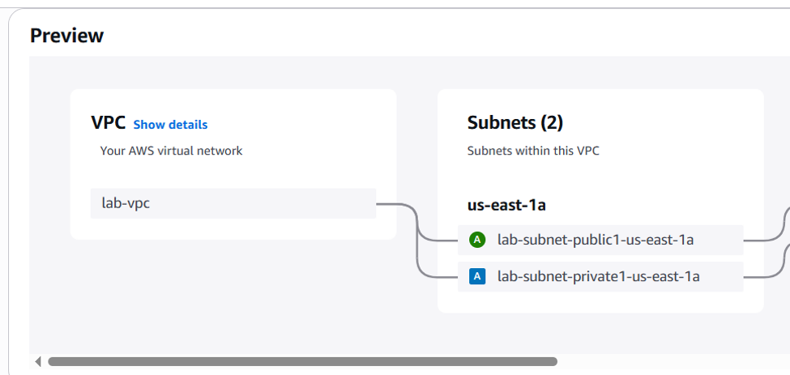
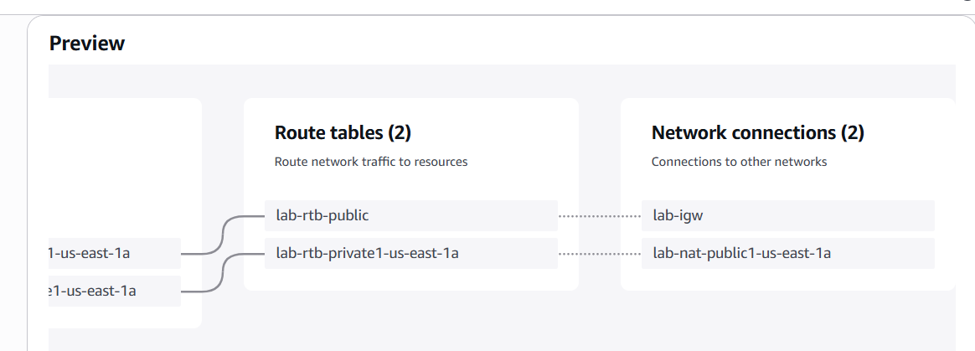
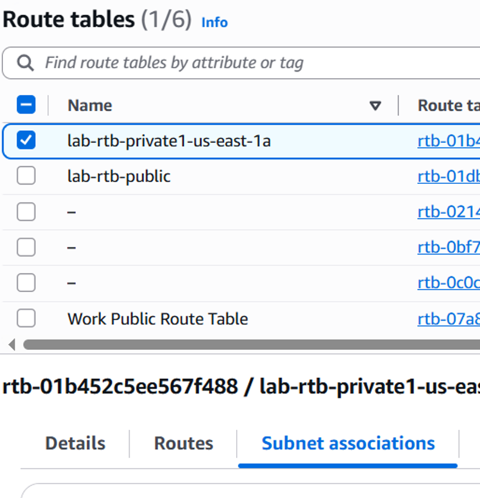
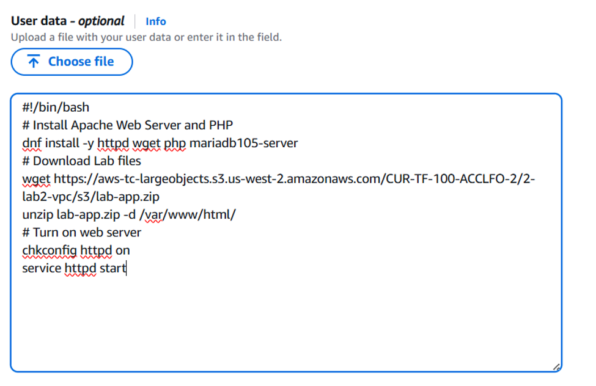
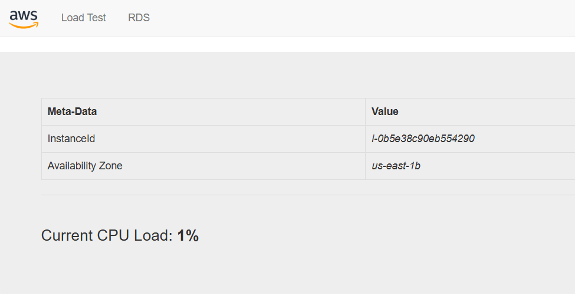

# AWS VPC and Web Server Deployment

I built a custom network in AWS from scratch, with public and private subnets across two Availability Zones, then launched a web server into it behind a firewall that only allows web traffic.

**Tools:** AWS VPC, EC2, Security Groups, Route Tables, Internet Gateway, NAT Gateway, Amazon Linux 2023, Apache

## Goal

Build a secure cloud network where:

- Public-facing resources, like a web server, can be reached from the internet
- Private resources, like a future database, are hidden from the internet but can still reach out for updates
- Only the traffic the application needs is allowed in

## Architecture

| Subnet | CIDR block | Availability Zone | Internet traffic goes to |
|---|---|---|---|
| Public subnet 1 | 10.0.0.0/24 | us-east-1a | Internet Gateway |
| Private subnet 1 | 10.0.1.0/24 | us-east-1a | NAT Gateway |
| Public subnet 2 | 10.0.2.0/24 | us-east-1b | Internet Gateway |
| Private subnet 2 | 10.0.3.0/24 | us-east-1b | NAT Gateway |

## Step 1: Create the VPC

I created a VPC called `lab-vpc` with the address range `10.0.0.0/16`, which gives the network about 65,000 private IP addresses to divide up. The setup also created one public subnet, one private subnet, an Internet Gateway, a NAT Gateway, and a route table for each subnet type.

## Step 2: Add subnets in a second Availability Zone

To make the network more resilient, I added a second public subnet (`10.0.2.0/24`) and a second private subnet (`10.0.3.0/24`) in a different Availability Zone. If one AWS data center has an outage, resources in the other zone can keep running.

## Step 3: Configure routing

Route tables decide where network traffic goes. **The route table, not the subnet's name, is what makes a subnet public or private.**

- **Public route table:** sends internet traffic (`0.0.0.0/0`) to the **Internet Gateway**, so resources can be reached from the internet.
- **Private route table:** sends internet traffic (`0.0.0.0/0`) to the **NAT Gateway**. Private resources can reach out to download updates, but nothing on the internet can start a connection to them.

I associated each new subnet with the matching route table: public subnet 2 with the public route table, and private subnet 2 with the private route table.

## Step 4: Create a security group

A security group is a virtual firewall attached to a server. I created `Web Security Group` with a single inbound rule:

| Type | Protocol | Port | Source | Why |
|---|---|---|---|---|
| HTTP | TCP | 80 | 0.0.0.0/0 (anywhere) | Lets anyone load the website |

Every other inbound port is blocked by default, including SSH (port 22) and HTTPS (port 443).

## Step 5: Launch the web server

I launched an EC2 instance called `Web Server 1` with these settings:

- **OS:** Amazon Linux 2023
- **Size:** t2.micro
- **Network:** `lab-vpc`, in **public subnet 2** with a public IP, so it's reachable from the internet
- **Firewall:** `Web Security Group`

I also added a **user data** startup script. It runs automatically the first time the server boots: it installs the Apache web server, PHP, and a database package, downloads a sample web app, and starts Apache. That means the server comes up ready to go without me logging in to set anything up.

The instance passed both AWS health checks:

## Result

The website loaded in my browser, showing the server's instance ID and its Availability Zone (`us-east-1b`), which confirms it ran in public subnet 2 as planned.

## Troubleshooting

At first, the site wouldn't load and the browser said "site can't be reached." The cause was that Chrome automatically tried to connect over **HTTPS (port 443)**, but my security group only allowed **HTTP (port 80)**, so the firewall blocked it. Typing `http://` in front of the address fixed it.

This showed me that the security group was doing exactly what I configured: only the traffic I explicitly allowed got through.

## Security notes

- **Least privilege:** only port 80 is open. SSH (port 22) was never opened, so nobody can log in to the server remotely, even though a key pair was attached.
- **No encryption:** the site runs over plain HTTP, and the browser flagged it as "Not secure." In production, I would add an SSL/TLS certificate, open port 443, and redirect HTTP to HTTPS.
- **Private subnets for sensitive data:** a database belongs in a private subnet. It could still get updates through the NAT Gateway, but it would never be directly reachable from the internet.
- **Open to everyone:** allowing `0.0.0.0/0` is fine for a public website, but rules for admin access like SSH should be limited to specific trusted IP addresses.
- **Redacted info:** public IP addresses and the public DNS name were removed from screenshots.

## What I learned

- How a VPC, subnets, route tables, and gateways fit together to form a network
- What actually makes a subnet public versus private
- How security groups act as a firewall, and how to troubleshoot a blocked connection
- How to automate server setup with a user data script
- Why spreading resources across Availability Zones improves reliability

*Built as part of an AWS Academy lab at the University of South Florida.*
