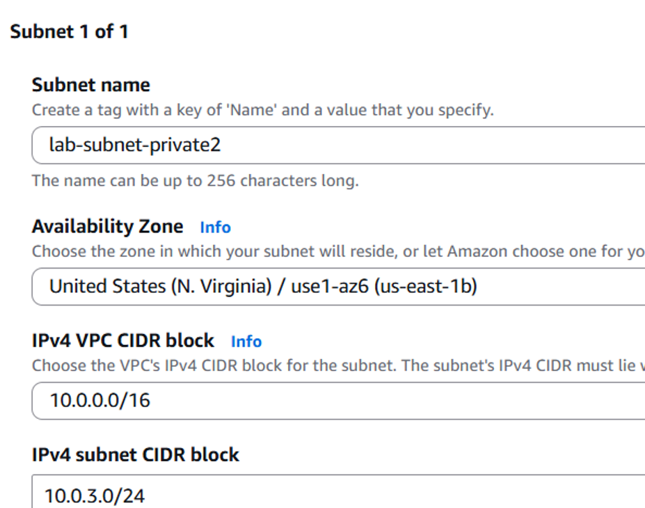
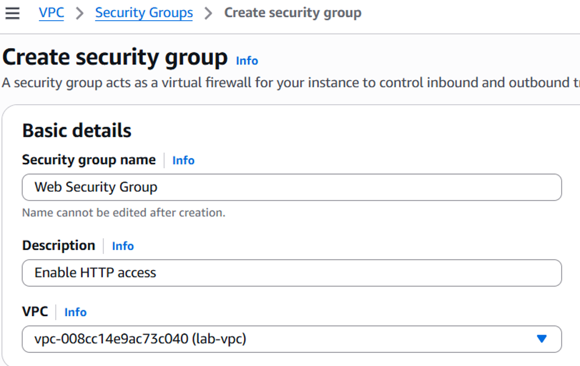
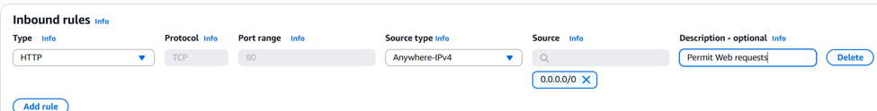

# AWS VPC and Web Server

Write-up of the "Build your VPC and launch a web server" lab from AWS Academy at USF. I built a VPC with public and private subnets in two Availability Zones and put a web server in it behind a security group that only allows HTTP.

**Services:** VPC, subnets, route tables, Internet Gateway, NAT Gateway, EC2 (Amazon Linux 2023), security groups

## 1. Create the VPC

I used the VPC wizard to create `lab-vpc` with the range `10.0.0.0/16`. The wizard also made the first public and private subnet in us-east-1a, an Internet Gateway, a NAT Gateway, and a route table for each subnet type.

## 2. Add subnets in a second Availability Zone

I added a second public subnet (`10.0.2.0/24`) and a second private subnet (`10.0.3.0/24`) by hand in us-east-1b, so the network isn't all in one zone.

The full layout:

| Subnet | CIDR | AZ | Default route |
|---|---|---|---|
| Public 1 | 10.0.0.0/24 | us-east-1a | Internet Gateway |
| Private 1 | 10.0.1.0/24 | us-east-1a | NAT Gateway |
| Public 2 | 10.0.2.0/24 | us-east-1b | Internet Gateway |
| Private 2 | 10.0.3.0/24 | us-east-1b | NAT Gateway |

## 3. Set up routing

I associated the new private subnet with the private route table, which sends internet traffic to the NAT Gateway, and the new public subnet with the public route table, which sends it to the Internet Gateway. A subnet is "public" only because of its route table. The name doesn't do anything.

## 4. Create the security group

I made `Web Security Group` with one inbound rule: HTTP (TCP 80) from anywhere. Everything else is blocked by default, including SSH.

## 5. Launch the web server

I launched `Web Server 1`, a t2.micro running Amazon Linux 2023, in Public subnet 2 with a public IP and the web security group. I added a user data script that installs Apache and PHP and pulls down a sample app on first boot.

The instance came up and passed both status checks.

## 6. Load the site

The page loaded and showed the instance ID and its Availability Zone (us-east-1b), which confirms it's running in Public subnet 2.

At first it wouldn't load. Chrome was trying HTTPS on port 443, and the security group only allows 80. Typing `http://` in front of the address fixed it.

## What I'd change for a real setup

- Add a TLS certificate, open 443, and redirect HTTP to HTTPS.
- If SSH were needed, allow it only from a specific IP instead of anywhere.
- Put the database in a private subnet so it can get updates through the NAT Gateway but can't be reached from the internet.

Public IPs and DNS names are blurred out of the screenshots.
